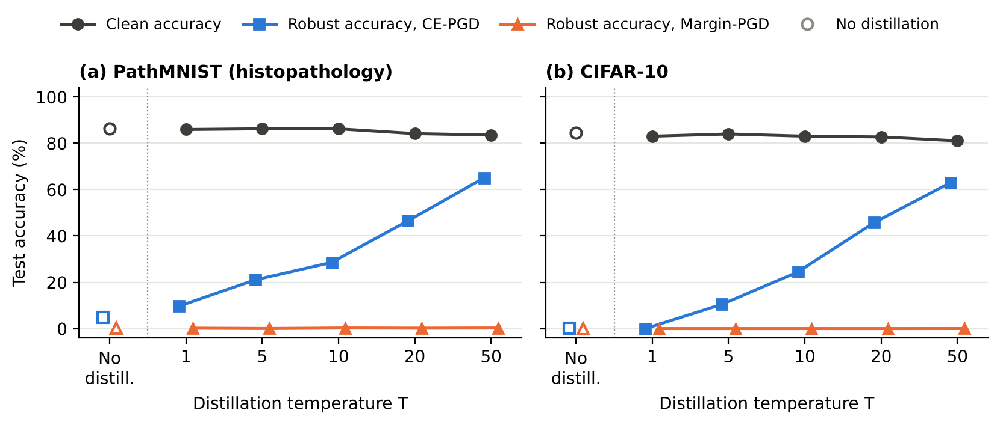

# Does a Smaller Gradient Mean a More Robust Model?

**Why this matters.** A defence is only as strong as the attack used to test it. If the attack relies on something
the defence happens to hide, the model looks robust when it is not. Such a false sense of security is hard to spot
from the numbers alone, and it matters most where models support decisions, as in medical imaging. Defensive
distillation (Papernot et al., 2016) is a well-known case: it makes input gradients vanish and was reported to stop
adversarial examples, but later work showed that defences of this kind hide the gradient rather than remove the
weakness (Carlini & Wagner, 2016; Athalye et al., 2018).

**Question.** Does the robustness of a distilled model survive an attack that does not use the softmax gradient, and
is a small input-gradient norm a reliable sign of robustness? The study first reproduces the effect on CIFAR-10, then
repeats it on PathMNIST, a dataset of histopathology image patches.

**Finding:** the protection only appears under an attack that follows the cross-entropy gradient. An attack on the
logits still succeeds on almost every image. Here, a small gradient does not mean a robust model.

*Both datasets use the same attack budget: L∞ PGD, ε = 8/255, 20 steps. Hollow markers show the model trained
without distillation.*

| Dataset | Model | Clean accuracy | Robust accuracy, CE-PGD | Robust accuracy, Margin-PGD |
|---|---|---|---|---|
| PathMNIST | No distillation | 86.21% | 4.82% | 0.18% |
| PathMNIST | T = 1 | 85.92% | 9.69% | 0.18% |
| PathMNIST | T = 5 | 86.24% | 21.06% | 0.03% |
| PathMNIST | T = 10 | 86.21% | 28.54% | 0.26% |
| PathMNIST | T = 20 | 84.16% | 46.49% | 0.18% |
| PathMNIST | T = 50 | 83.51% | **65.10%** | **0.25%** |
| CIFAR-10 | No distillation | 84.49% | 0.18% | 0.00% |
| CIFAR-10 | T = 1 | 83.03% | 0.00% | 0.00% |
| CIFAR-10 | T = 5 | 83.99% | 10.44% | 0.00% |
| CIFAR-10 | T = 10 | 83.04% | 24.47% | 0.00% |
| CIFAR-10 | T = 20 | 82.72% | 45.75% | 0.00% |
| CIFAR-10 | T = 50 | 81.04% | **63.03%** | **0.02%** |

## Why the gradient is misleading

After distillation at a high temperature T, the network's output scores (logits) become very large. At test time the
softmax then saturates: the predicted class gets a probability of almost exactly 1, and the cross-entropy gradient
becomes zero in float32. At T = 50 this happens for 94% of the correctly classified test images on PathMNIST and 86%
on CIFAR-10. For these images, an attack that follows this gradient has no direction to move in, so the model looks
more robust than it is.

Margin-PGD works on the difference between the logits, which does not pass through the softmax. It still finds
adversarial examples for almost all images, so the distilled models are not harder to attack. This is consistent with
gradient masking, as described by Carlini & Wagner (2016). A small average gradient norm is therefore not a reliable
sign of robustness.

## Setup

- **Model:** the small CNN of Papernot et al. (4 convolutional layers, 2 hidden fully connected layers).
- **Distillation:** for each T in {1, 5, 10, 20, 50}, a teacher is trained at temperature T, and a student with the
  same architecture is trained on the teacher's soft labels at the same T. Students are tested at T = 1.
- **Attacks:** CE-PGD (cross-entropy loss) and Margin-PGD (logit margin, as in the Carlini-Wagner loss), with the same
  budget.
- **Data:** CIFAR-10 (100 epochs) and PathMNIST from MedMNIST (9 tissue classes, 28×28 pixels, 50 epochs).

Full settings, training checks and the gradient analysis are in the notebooks.

## What this means

A robustness claim should be tested with more than one attack loss, including one that works on the logits. A small
gradient norm is not evidence of robustness on its own.

## Limitations and next steps

- One small CNN, low-resolution images and one training run per model.
- One attack budget (ε = 8/255, 20 steps, one restart).
- On PathMNIST, test accuracy (about 86%) is much lower than validation accuracy (about 98%). The test set is a
  separate dataset (CRC-VAL-HE-7K) from the training data (NCT-CRC-HE-100K). This project does not study this gap.
- Next: standard stronger attacks such as AutoAttack, and larger models on full-resolution pathology images.

## Files

| File | Content |
|---|---|
| `pathmnist.ipynb` | PathMNIST experiment: training, attacks, gradient analysis |
| `cifar10.ipynb` | CIFAR-10 experiment, same pipeline |
| `figures/` | The figure above and the script that draws it from the notebook outputs |

The notebooks run on Kaggle with a GPU (*Save & Run All*). All settings are in the configuration cell. Without saved
models, a run trains every model from scratch (about 2.5 hours for PathMNIST). To run them locally, put `cifar-10-batches-py/` or
`pathmnist.npz` (available through the `medmnist` package) next to the notebook. Trained models are saved together
with their training configuration and are reloaded on later runs.

## References

- N. Papernot, P. McDaniel, X. Wu, S. Jha, A. Swami. *Distillation as a Defense to Adversarial Perturbations against
  Deep Neural Networks.* IEEE S&P 2016.
- N. Carlini, D. Wagner. *Defensive Distillation is Not Robust to Adversarial Examples.* arXiv:1607.04311, 2016.
- A. Athalye, N. Carlini, D. Wagner. *Obfuscated Gradients Give a False Sense of Security: Circumventing Defenses to
  Adversarial Examples.* ICML 2018.
- A. Madry, A. Makelov, L. Schmidt, D. Tsipras, A. Vladu. *Towards Deep Learning Models Resistant to Adversarial
  Attacks.* ICLR 2018.
- J. Yang et al. *MedMNIST v2: A large-scale lightweight benchmark for 2D and 3D biomedical image classification.*
  Scientific Data 10, 41 (2023).
- J. N. Kather et al. *Predicting survival from colorectal cancer histology slides using deep learning: A
  retrospective multicenter study.* PLOS Medicine 16(1), e1002730 (2019).
